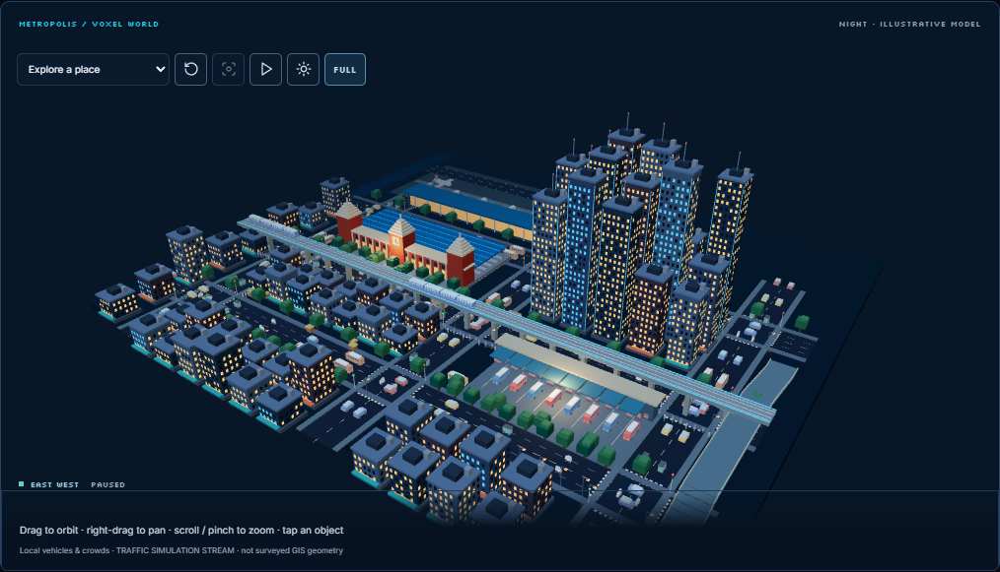

# Urban Intelligence — South India

React/Vite operations dashboard, FastAPI API, streaming city state, optional Groq Copilot, and an interactive voxel metropolis. This source package continues the supplied project; it is not a replacement application.

## Quick start (Windows, compatibility engine)

Use Python 3.12 and Node.js 22 or newer. From the extracted project folder:

```powershell
py -3.12 -m venv .venv
.\.venv\Scripts\python.exe -m pip install -r requirements-dev.txt
Copy-Item .env.example .env
.\.venv\Scripts\python.exe src/main.py --host 0.0.0.0 --port 8000
```

In a second terminal:

```powershell
cd frontend
npm ci
Copy-Item .env.example .env.local
npm run dev
```

Open http://127.0.0.1:5173, create an account, and select **3D metropolis**. The development example calls http://localhost:8000; use one consistent hostname if your browser restricts cross-site cookies. For an all-127.0.0.1 setup set `VITE_API_BASE_URL=http://127.0.0.1:8000` in `frontend/.env.local`. Both frontend origins are included in the backend CORS example. Restart Vite after changing environment values. Account/session SQLite files are created locally and are not shipped.

For completely offline generated telemetry, set backend `DATA_MODE=simulation`. `hybrid` additionally requests Open-Meteo weather and air-quality data; connection failures are reported, not replaced by invented measurements. Optional `--mode urban_planning` starts the repaired, explicitly labelled planning generators.

## Native Pathway (Linux)

Use Python 3.11 on Linux, preferably in a virtual environment:

```bash
python3.11 -m venv .venv
source .venv/bin/activate
pip install -r requirements-render.txt
cp .env.example .env
python src/main.py --host 0.0.0.0 --port 8000
```

`requirements-render.txt` pins Pathway 0.33.0. Windows uses `src/pathway_compat.py`; it is a lightweight compatibility implementation, not the native differential engine. Do not use multiple API workers or duplicate application processes: streaming state is process-local. The supported entry is `src/main.py`, not a standalone `uvicorn` invocation that omits connectors. The optional legacy Streamlit surface requires the extra packages in `requirements.txt`; it is not the active React UI.

## 3D controls and provenance

- Left-drag or one-finger drag: orbit. Right-drag or two-finger gesture: pan. Wheel/pinch: zoom.
- **Explore a place** selects and focuses a station, airport, bus interchange, junction or building. Click/tap geometry or transport for entity details. Crosshair focuses the selection; reset restores overview.
- Pause/play controls generated transport and crowds. Sun/moon changes lighting. **ECO** lowers actor counts and caps pixel ratio; **FULL** restores detail. Reduced-motion preference pauses simulation. Offscreen scenes stop advancing.
- Signals follow a 28-second cycle: east/west green, amber, north/south green, amber, then a pedestrian phase. Vehicles use separate lanes with headway limits and stoplines. This is approximate traffic behaviour, not physics or traffic engineering software.
- The world includes a terracotta terminus with six platforms, regional trains, elevated metro, airport terminal/runway/control tower and parked aircraft, a timed departure loop, an eight-bay bus terminal, a circulating bus, detailed towers/neighbourhoods, flyover, crossing markings, a small planted island, street furniture, and block pedestrians. Shared instanced geometry handles repeated details and actors. No reference image is used as a background or billboard.
- All voxel architecture, vehicles and people are **illustrative local simulation objects**. They are not verified assets, GPS tracks, surveyed roads, or a reconstruction of a specific South Indian city. Entity panels explicitly say when there is no matched backend record. A selected moving actor's focus is a snapshot, not live camera-follow.
- **Geographic evidence** is a separate regional coordinate projection. Actual backend latitude/longitude determines city and record positions. Tall bars encode risk, diamonds encode records, and short bars encode simulated congestion at source coordinates. Heights are not terrain or buildings. Missing coordinates are omitted. The map below supplies street context and an overlap picker.
- City/event selection is shared across the map, geographic view, city inspector, event queues and workspace navigation. Voxel city context follows the selected city but does not relocate illustrative buildings to fictional GIS positions. Weather, AQI, risk, timestamps and traffic summaries come from `/api/state`.
- **TRAFFIC SIMULATION STREAM** is generated on the backend. Social, scanner, IoT and optional planning feeds are also labelled simulations. Open-Meteo observations are external provider data; webhook records are supplied by callers. GTFS is NOT_CONFIGURED without a feed URL. The current adapter only checks HTTP reachability; it does not decode GTFS observations. READY/REACHABLE must not be interpreted as live transit data. “Receiving/LIVE” source status means data arrival, not necessarily real-world provenance; check the separate source mode.

## Source-status contract

Configuration/status notices never increment observation counts, timestamps, city state or RAG evidence. `/api/health` and `/api/state` expose `observation_status`, `connector_status`, `last_update`, `last_checked_at` and `mode` separately. OFFLINE/DEGRADED connectors cannot appear LIVE merely because an earlier observation remains fresh. Simulation provenance is retained even before the first generated record.

## Backend fixes

`create_pathway_sink` accepts native `key`, `row`, `time`, `is_addition` arguments. Retractions are not ingested as new incidents. Native JSON is converted to dictionaries. All output subscriptions are registered before `pw.run()`; the regression executes two non-empty records through the connector, anomaly UDF, filter and production sink. The compatibility connector no longer double-delivers rows; retained table snapshots are bounded.

Shared state is locked, measured history replaces fabricated history, source health reflects connector state, missing locations stay unlocated, and source city labels are used as city-level groups. The existing heuristic risk model is preserved. The frontend also guards against an old session response undoing a completed signup/login.

## Optional Groq

Set `GROQ_API_KEY` only in the backend environment. Never put it in any `VITE_*` variable. The existing model is `llama-3.3-70b-versatile`; configuration YAML can override model settings. Without a valid key, or when the provider fails/times out, Copilot returns an explicitly labelled deterministic assessment of available state and retrieved evidence. No OpenAI SDK or API dependency was added. Live Groq access was not tested because no key was supplied; absence and provider-failure paths were tested. Suggestions remain operator decision support.

## Verification — 13 October 2026

| Check | Actual result |
| --- | --- |
| Full Python suite on Windows compatibility runtime | **58 passed, 1 skipped**, 2 dependency deprecation warnings |
| Non-empty stream regression | **PASS**, 2 records exactly once, anomalies reach filtered sink, `native=False` |
| Native Pathway 0.33.0 execution | **PASS on Linux CI**: version 0.33.0 asserted, non-empty stream `native=True`, **3 passed, 0 skipped** in the native subscription suite |
| TypeScript + Vite production build | **PASS**; lazy Three.js chunk approximately 915 KB / 249 KB gzip triggers a size warning |
| Playwright Chromium suite | **8 passed**: auth, delayed-session regression, routes, map selection, Copilot, voxel controls, mobile/reduced motion, WebGL failure handling |
| Build-time API origin | **PASS** build with explicit local validation origin http://127.0.0.1:10000; no healthy production origin verified |
| Production-like local startup | **PASS**, `python src/main.py --host 0.0.0.0 --port 10000` |
| Live HTTP smoke | **PASS** health, protected state, signup, session, webhook, history, Copilot, logout, login, stream progression |
| Offline external providers | Regression tests pass for network failure and HTTP 503; freshness history is retained separately from current connector health |
| Existing Render backend | **HTTP 503 — UNRESOLVED**. Read-only health request still returns 503; authenticated Render logs unavailable; no deployment |

Run tests from project root:

```powershell
.\.venv\Scripts\python.exe -m pytest tests -q
.\.venv\Scripts\python.exe tests/stream_regression.py
```

Verified Linux CI run: [38337027995](https://github.com/hariharasuthan1105/pathway-safety-urban-planning/actions/runs/38337027995) (native Pathway, full compatibility suite, and frontend build passed). This covers the finite native subscription regression, not a deployed service or every backend test under native execution.

On native Linux install `pytest` and run `python -m pytest tests/test_subscription_contract.py -q`. This must succeed before treating native execution as verified.

For browser tests, run the backend on port **10000**, start Vite with `VITE_API_BASE_URL=http://127.0.0.1:10000`, then:

```powershell
cd frontend
npx playwright install chromium
npm run test:e2e
```

`PLAYWRIGHT_EXECUTABLE_PATH` can select an existing compatible Chromium installation. The tests create disposable local accounts. Screenshot paths currently target an `outputs` directory two levels above the project; Playwright creates it. Run `python tests/runtime_smoke.py` separately against the running port-10000 backend (`SMOKE_API_URL` overrides it).

## Frontend hosting and publishing

The existing public frontend is hosted on **GitHub Pages**, currently configured to publish `main` from repository root (`/`). That root contains the legacy HTML/Three.js application with OpenAI branding and a hardcoded localhost API. Merged main `5857851c24474d8a5bdf90fc4b8434c3f14dc818` contains the voxel React project, but the CI build does not publish its output. This explains the old live frontend; clearing browser cache cannot replace the wrong artifact.

Active React entry: `frontend/index.html` → `frontend/src/main.tsx` → `frontend/src/app/App.tsx`. `/` and `/login` mount `features/three/CityScene.tsx`; `/app/digital-twin` mounts the same scene in the protected workspace. `frontend/src/App.tsx` and root `index.html` are separate legacy entries, not imports of this application.

See [the exact Pages publishing steps](docs/FRONTEND_HOSTING.md). `.github/workflows/pages.yml` builds from `frontend`, uploads `frontend/dist`, and publishes only via an owner-approved manual run on `main`. It requires a repository variable containing the verified HTTPS backend origin, checks `/api/health`, and rejects loopback targets. No hosting settings or deployments were changed during the investigation.

## Production configuration and Render

Copy `frontend/.env.production.example` to `frontend/.env.production`, set `VITE_API_BASE_URL` to the verified API origin, then run `npm ci && npm run build`. Production builds reject an empty or invalid origin; no production API proxy is assumed. Vite development proxy settings do not create a hosted proxy. Environment changes require rebuilding the static frontend. The production example deliberately leaves the origin blank. The previously used **https://urban-intelligence-backend-z869.onrender.com** still returns HTTP 503 and is not selected as a production target. A verified backend origin remains a required deployment configuration step.

`render.yaml` defines the existing Python entry command, `/api/health`, one backend instance, static frontend SPA rewrite and an auth SQLite disk. The Blueprint selects a paid instance and mounts the authentication disk at `/var/data`; only data under that mount persists. Automatic deploy triggers are off in this source configuration. These settings have not been applied to the existing Render service. Preserve or migrate any existing auth database before changing its storage path. See [Render persistent disks](https://render.com/docs/disks). Set `CORS_ORIGINS` to the exact HTTPS frontend origin, `COOKIE_SECURE=true`, `COOKIE_SAMESITE=none`, `AUTH_DB_PATH=/var/data/auth_store.db`; keep Groq optional and server-side. Cross-site cookie blocking can require serving frontend/API under a shared site. Set the frontend API origin to the actual deployed backend URL and rebuild. Deployment acceptance alone is not success: inspect logs, native stream processing and repeated successful health/API responses. No deployment was performed.

## Known limits

This is a runnable, locally verified implementation, not certification of production deployment or performance on every device. Native Pathway 0.33.0 streaming is verified in Linux CI; the Render deployment remains unverified. The voxel scene uses simplified motion and geometry, no full collision physics, no first-person/follow camera, and no surveyed asset matching. Its scale and visual treatment are inspired by the reference rather than an exact reproduction. ECO and reduced-motion modes help lower-end devices; hardware-specific frame-rate benchmarks were not performed.

Runtime telemetry and history are in-memory and reset on restart; SQLite persists accounts only. Compatibility CSV/JSON sinks are diagnostic stubs, unlike native outputs. The retained heuristic risk score can saturate under frequent simulated events; it is not a calibrated probability or forecast. Recent event lists are a limited returned subset, while summary counts cover a larger rolling window. Default legacy zone boundaries are retained for unnamed historical inputs; source-city-labelled regional events are grouped by that label, not surveyed wards. External providers and map tiles require network access and remain subject to availability and usage policies. OpenStreetMap attribution is displayed; use a suitable tile service for higher-volume hosting.

The ZIP excludes node_modules, virtual environments, caches, builds, local databases, logs and real environment files. It includes source, tests, manifests/lockfile, safe environment examples and deployment configuration. See `docs/CHANGE_AUDIT.md` for the source audit and `docs/REDESIGN_ARCHITECTURE.md` for architecture notes.

## Preview



This revision continues the retained voxel project and preserves the existing GitHub history on `codex/voxel-telemetry-reliability`. No Render deployment is authorized or performed.
